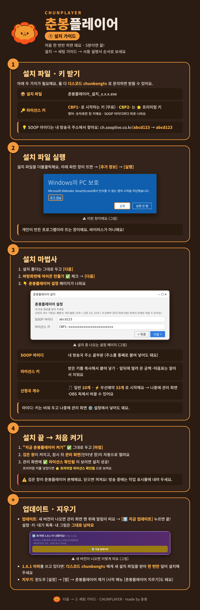
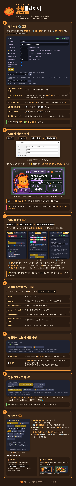
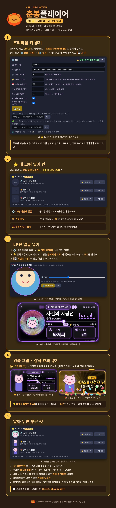

# 🎵 춘봉플레이어 (CHUNPLAYER)

**SOOP 방송용 신청곡 플레이어** — 시청자가 별풍선·애드벌룬을 후원하고 채팅으로 노래를 신청하면, 유튜브에서 찾아서 방송 화면(OBS · 프릭샷)에 순서대로 틀어 줘요.

## ⬇️ 받기

### 👉 [춘봉플레이어 1.9.7 설치 파일 받기](https://github.com/chunbongtv/chunplayer/releases/download/v1.9.7/ChunbongPlayer_Setup_1.9.7.exe)

- 📚 [그림 설명서 한꺼번에 받기 (zip)](https://github.com/chunbongtv/chunplayer/releases/download/v1.9.7/ChunbongPlayer_Manual.zip)
- 🗂 [지난 버전 · 업데이트 기록](https://github.com/chunbongtv/chunplayer/releases)

> ⚠️ **라이선스 키가 있어야 쓸 수 있어요.** 키는 **디스코드 `chunbongtv`** 로 SOOP 아이디와 함께 문의해 주세요.
> 
> 이미 1.7.0 이상을 쓰고 있다면, 관리 화면에 뜨는 **[⬆️ 지금 업데이트]** 버튼만 누르면 돼요. (설정·라이선스·대기 목록·내 그림은 그대로)

## ✨ 이런 걸 해요

- 💬 후원 후 채팅에 `!제목 가수` 또는 유튜브·SOOP 클립 링크 → 신청 끝
- ⚡ **우선예약** — 더 많이 후원하면 대기 목록 맨 앞으로 + 금색 축하 효과
- 🎯 원곡 위주로 찾아요 (라이브·반응 영상은 걸러요)
- 🎉 신청곡 감사 효과 · 📋 `!순서` 순서표 · 🎶 신청곡 없을 땐 대기곡 자동 재생
- 💰 신청·우선예약 별풍선 개수 마음대로 · 🔒 버튼 하나로 신청 마감
- 🖼 홍보 배너 · 🧩 OBS 독 하나로 전부 조종 · ⬆️ 버튼 하나로 업데이트

## 🆓 무료 · ⭐ 프리미엄

| | 🆓 무료 | ⭐ 프리미엄 (50,000원) |
|---|:---:|:---:|
| 신청곡 · 우선예약 · 감사 효과 · 순서표 · 대기곡 · 배너 | ✅ | ✅ |
| 💿 LP판 / 🦁 DJ 춘봉이 · 테두리 색 12가지 · 배경 진하기 | ✅ | ✅ |
| 🖼 **내 그림 넣기** (LP판 얼굴 · 왼쪽 그림 · 감사 효과) | | ✅ |
| 🖌 **배경색** 11가지 + 팔레트로 직접 고르기 | | ✅ |
| 🔤 **글꼴** 7가지 · 🖍 **글씨 색** · 🎨 **테두리 색 직접 고르기** | | ✅ |

무료 키는 `CBP1-`, 프리미엄 키는 `CBP2-` 로 시작해요. 무료로 쓰다가 프리미엄 키만 넣어도 바로 열려요. (다시 설치할 필요 없어요)

## 🆕 이번 버전 (1.9.7)

- 🖼 프리미엄 "내 그림 넣기"로 왼쪽 그림을 바꿔도, 재생창을 다시 켜면 춘봉이 그림으로 돌아가던 문제를 고쳤어요
    - 보라색이 아닌 색 테마를 쓸 때 생기던 문제예요
- 색 테마를 빠르게 여러 번 바꾸면 그림 색이 예전 색으로 남던 문제를 고쳤어요
- 관리 화면에서 버튼 하나가 오류가 나도 연결이 끊기지 않게 했어요

📜 지난 업데이트 보기

**1.9.6 업데이트**

- ⭐ 세로형 · 미니형 · 심플형 레이아웃은 프리미엄 전용이 됐어요
    - 무료판은 기본 가로형으로 쓸 수 있어요
    - 프리미엄 키가 없으면 재생창이 가로형으로 돌아가요 (키를 넣으면 고른 모양이 그대로 돌아와요)

**1.9.5 업데이트**

- 📐 재생창 레이아웃을 고를 수 있어요 (관리 화면 [화면 꾸미기] → 레이아웃)
    - ▭ 가로형(기본) · ▯ 세로형 · ▬ 미니형 · ◻ 심플형(배경 상자 없이 깔끔)
    - OBS에서 소스 크기만 맞추면 돼요

**1.9.4 업데이트**

- ⭐ 프리미엄 꾸미기가 생겼어요 (프리미엄 키가 있어야 해요)
    - 🖌 배경색 11가지 + 팔레트로 직접 고르기 (밝은 배경이면 글자가 알아서 진하게)
    - 🔤 글꼴 7가지 (기본·주아·검은고딕·도현·개구·해바라기·쿠키런)
    - 🖍 곡 제목·신청자·대기곡 글씨 색 + 직접 고르기
    - 🎨 테두리 색 팔레트로 직접 고르기
    - 🖼 내 그림 넣기 (LP판 얼굴 · 왼쪽 그림 · 감사 효과)
- 무료판은 지금처럼 재생창 색 12가지 · LP판/춘봉이 · 배경 진하기를 그대로 쓸 수 있어요

**1.9.2 업데이트**

- 검은 창에 노란 WARNING 글자가 잔뜩 뜨던 걸 안 뜨게 했어요 (동작에는 원래 문제 없었어요)

**1.9.1 업데이트**

- 라이선스 키를 영어·숫자만 쓰는 모양으로 바꿨어요 (디스코드로 보내도 안 깨져요)
- 키를 붙여 넣을 때 딸려 온 공백·따옴표·백틱(`)은 알아서 지워요
- 예전에 받은 키도 그대로 쓸 수 있어요

**1.9.0 업데이트**

- ⭐ 프리미엄 기능 "내 그림 넣기"가 생겼어요 (프리미엄 키가 있어야 해요)
    - LP판 가운데 얼굴 / 왼쪽 그림 / 신청곡 감사 효과를 내 그림으로 바꿀 수 있어요
    - 관리 화면 [화면 꾸미기] → [⭐ 내 그림 넣기]에서 그림 파일을 올리면 바로 바뀌어요
    - 프리미엄 키는 디스코드 chunbongtv 로 문의해 주세요
- 관리 화면 [화면 꾸미기]에서 재생창 왼쪽 그림을 고를 수 있어요: 💿 LP판 / 🦁 춘봉이

## 📖 그림 설명서

### 1. 설치가이드

### 2. 세팅가이드

### 3. 사용설명서

### 4. 시청자 신청방법

### 5. 프리미엄 내그림넣기

---
💬 문의 · 라이선스 키 · 프리미엄 : **디스코드 `chunbongtv`**

made by 춘봉 🦁
