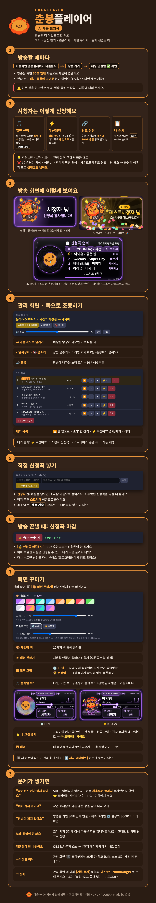

# 🎵 춘봉플레이어 (CHUNPLAYER)

SOOP 방송용 신청곡 플레이어예요. 별풍선·애드벌룬 후원 + 채팅으로 유튜브 노래를 신청받아 OBS·프릭샷 화면에서 재생해요.

## ⬇️ 받기

### 👉 [춘봉플레이어 1.8.0 설치 파일 받기](https://github.com/chunbongtv/chunplayer/releases/download/v1.8.0/ChunbongPlayer_Setup_1.8.0.exe)

- 📚 [그림 설명서 한꺼번에 받기 (zip)](https://github.com/chunbongtv/chunplayer/releases/download/v1.8.0/ChunbongPlayer_Manual.zip)
- 🗂 [지난 버전 · 업데이트 기록](https://github.com/chunbongtv/chunplayer/releases)

> ⚠️ **라이선스 키가 있어야 쓸 수 있어요.** 키는 SOOP 스트리머 **춘봉(chunbongtv)** 에게 DM으로 받아 주세요.
> 
> 이미 1.7.0 이상을 쓰고 있다면, 관리 화면에 뜨는 **[⬆️ 지금 업데이트]** 버튼만 누르면 돼요. (설정·라이선스·대기 목록은 그대로)

## 🆕 이번 버전 (1.8.0)

1.8.0 업데이트

- 재생창 왼쪽 그림이 빙글빙글 도는 LP판으로 바뀌었어요 (가운데 라벨에 춘봉이 얼굴)
- LP판 바깥에 지금 나오는 노래의 유튜브 썸네일이 보여요
- 오른쪽 위는 CHUNPLAYER 글씨만 남겼어요
- 관리 화면 '춘봉이 둠칫 속도' → 'LP판 도는 속도'
- 신청곡·우선예약 감사 효과에 나오는 춘봉이 그림이 새로 바뀌었어요

## 📖 설명서

### 1. 설치가이드

### 2. 세팅가이드

### 3. 사용설명서

### 4. 시청자 신청방법

---
made by 춘봉 🦁
