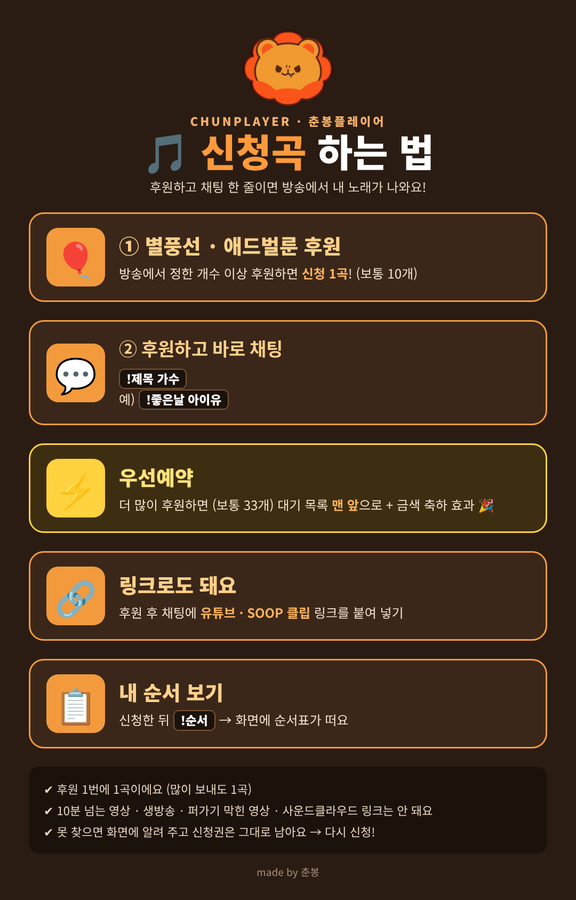

# 🎵 춘봉플레이어 (CHUNPLAYER)

SOOP 방송용 신청곡 플레이어예요. 별풍선·애드벌룬 후원 + 채팅으로 유튜브 노래를 신청받아 OBS·프릭샷 화면에서 재생해요.

## ⬇️ 받기

### 👉 [춘봉플레이어 1.7.0 설치 파일 받기](https://github.com/chunbongtv/chunplayer/releases/download/v1.7.0/ChunbongPlayer_Setup_1.7.0.exe)

- 📚 [그림 설명서 한꺼번에 받기 (zip)](https://github.com/chunbongtv/chunplayer/releases/download/v1.7.0/ChunbongPlayer_Manual.zip)
- 🗂 [지난 버전 · 업데이트 기록](https://github.com/chunbongtv/chunplayer/releases)

> ⚠️ **라이선스 키가 있어야 쓸 수 있어요.** 키는 SOOP 스트리머 **춘봉(chunbongtv)** 에게 DM으로 받아 주세요.
> 
> 이미 1.7.0 이상을 쓰고 있다면, 관리 화면에 뜨는 **[⬆️ 지금 업데이트]** 버튼만 누르면 돼요. (설정·라이선스·대기 목록은 그대로)

## 🆕 이번 버전 (1.7.0)

1.7.0 업데이트

- 배너 띄우기: 따로 띄우기 / 재생창과 번갈아 · 효과 6가지
- 관리 화면을 방송 · 화면 꾸미기 · 설정·시험 페이지로 나눔
- 재생창 배경 진하기, 춘봉이 둠칫 속도 조절
- 신청권 유효시간을 설정에서 바꿀 수 있음 (새로 설치하면 기본 30분)
- 새 버전이 나오면 관리 화면에 [지금 업데이트] 버튼이 떠요

## 📖 설명서

### 1. 설치가이드

### 2. 세팅가이드

### 3. 사용설명서

### 4. 시청자 신청방법

---
made by 춘봉 🦁
